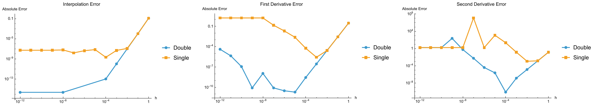

# Finite-precision numerics: finite differences and root finding

Two small experiments on how floating-point arithmetic limits basic numerical
methods, written in Wolfram Language (Mathematica).

## 1. How small should the step size be? (`finite_differences.wl`)

For f(x) = eˣ at x₀ = 0.5, a quadratic is interpolated through the nodes
x₀ − h, x₀, x₀ + h. Its coefficients give approximations of f, f′ and f″
(central differences). The step is varied over h = 10⁰ … 10⁻¹² in double
precision and in simulated single precision (`Real32`).

The error first decreases as truncation error shrinks (∝ h² for f′), then grows
again as round-off error dominates (∝ ε/h for f′, ε/h² for f″). The measured
optimal steps match the classical estimates:

| | optimal h, measured | estimate | smallest error |
|---|---|---|---|
| f′, double | 10⁻⁵ | ε^(1/3) ≈ 5·10⁻⁶ | 1.9·10⁻¹¹ |
| f″, double | 10⁻⁴ | ε^(1/4) ≈ 1·10⁻⁴ | 8.1·10⁻¹¹ |
| f′, single | 10⁻³ | ε^(1/3) ≈ 4·10⁻³ | 2.7·10⁻⁶ |
| f″, single | 10⁻² | ε^(1/4) ≈ 2·10⁻² | 1.1·10⁻³ |

In single precision, the nodes themselves collapse for h ≤ 10⁻⁸ (`0.5 + h == 0.5`),
so the derivative estimates become meaningless.

## 2. Bisection vs. fixed-point iteration (`root_finding.wl`)

Root of x³ − x − 1 (x* ≈ 1.3247), tolerance 10⁻¹⁰:

| method | iterations | convergence |
|---|---|---|
| bisection on [1, 2] | 33 halvings | linear, factor 1/2 per step |
| x ← (1 + x)^(1/3) | 15 | linear, factor \|g′(x*)\| ≈ 0.19 |
| y ← y³ − 1 | diverges (1, 0, −1, −2, −9, −730, …) | \|g′(x*)\| ≈ 5.3 > 1 |

The two fixed-point maps have the same fixed point. Only the one that is a
contraction near x* converges.

## Run

Open the `.wl` files in Mathematica and evaluate them (no packages needed).

## Notes

Developed from coursework in *Foundations of Numerical Methods* (AMS 527,
Stony Brook University, Fall 2026).
