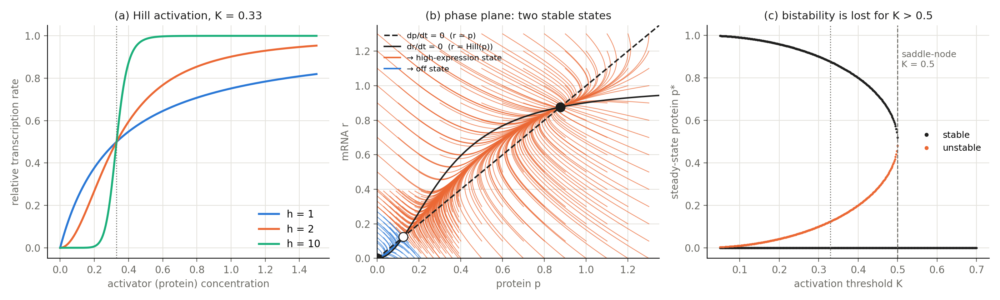

# A self-activating gene is a bistable switch

A gene whose protein activates its own transcription is one of the simplest
regulatory circuits. Can it store a memory, that is, settle in different states
depending on its history?

## Model

```
dr/dt = p² / (K² + p²) − r        mRNA, Hill activation by its own protein
dp/dt = r − p                     protein
```

with Hill coefficient h = 2 and activation threshold K = 0.33 (unit synthesis and
degradation rates). It is integrated with forward Euler (dt = 0.01). Steady states
are found analytically and their stability from the eigenvalues of the Jacobian.

## Results



* **(a)** Cooperativity (h > 1) turns a graded response into a sigmoidal switch.
* **(b)** The two nullclines (`r = p` and `r = Hill(p)`) intersect three times:

  | steady state p* = r* | stability |
  |---|---|
  | 0 | stable ("off") |
  | 0.124 | unstable saddle |
  | 0.876 | stable ("on") |

  Trajectories from a grid of initial conditions end in one of the two
  stable states. The stable manifold of the saddle separates the two basins.
  For example, starting at (p, r) = (0.4, 0) the gene switches on, but
  starting at (0.2, 0) it decays to off.
* **(c)** The off state is always present. The on state and the saddle appear
  only for K < 0.5 (`1 − 4K² ≥ 0`), where they merge in a saddle-node
  bifurcation. A weak activator (large K) cannot sustain its own expression.

Biologically, this is the basis of cellular memory. A transient signal that pushes
the protein above the threshold switches the gene on permanently, which is useful
for irreversible decisions such as differentiation.

## Run

```bash
python autoregulation.py     # writes figures/autoregulation.png
```

## Notes

* Built on an assignment from *Computational Modeling of Physiological Systems*
  (AMS/BIO 332, Stony Brook University, Spring 2026). The original analysis
  concluded that the system was monostable. The "off" state at the origin is easy
  to miss in a phase-plane plot because its basin is small. The fixed-point and stability analysis,
  the refined phase plane and the bifurcation sweep over K were added here.
