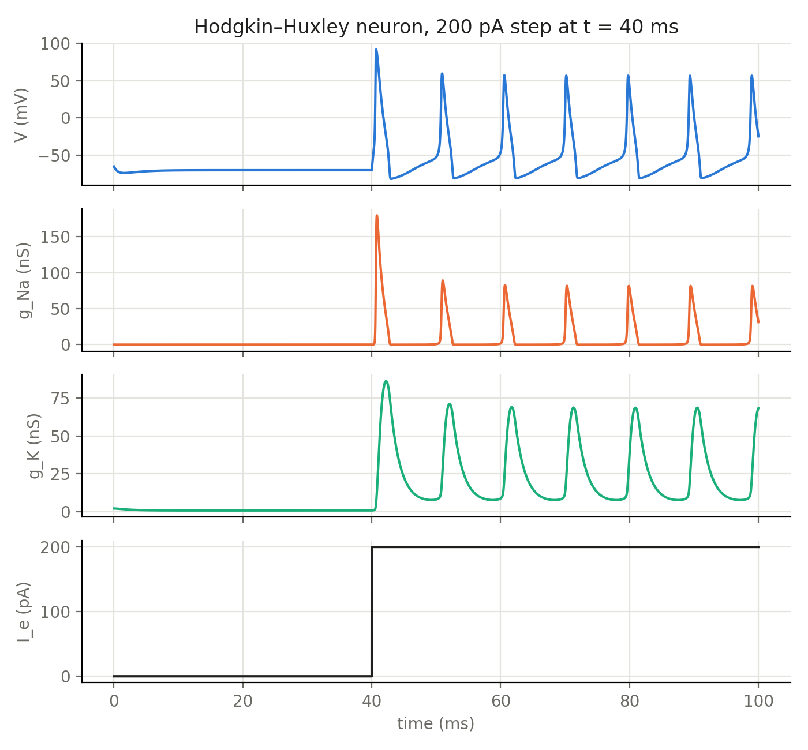
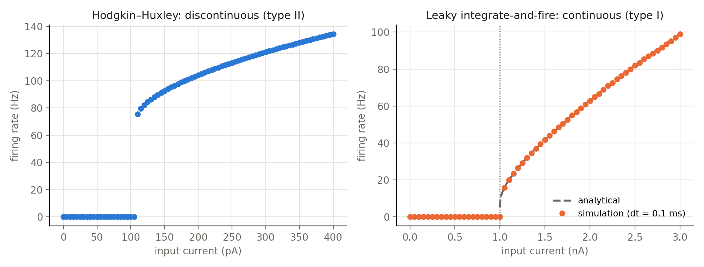
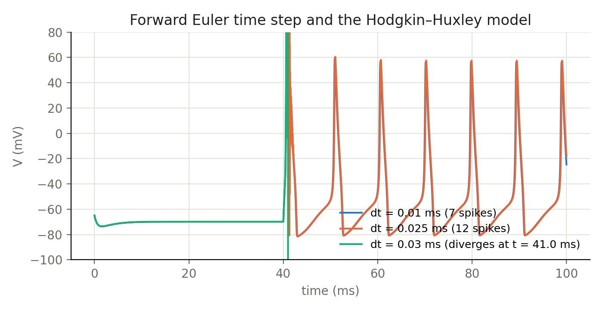

# Spiking neuron models: Hodgkin–Huxley vs. leaky integrate-and-fire

How does a neuron turn a constant input current into a firing rate, and how much
does the answer depend on the model and on the numerical integrator?

## Models

* **Hodgkin–Huxley (HH)**: membrane potential plus three voltage-gated variables
  (Na⁺ activation `m`, Na⁺ inactivation `h`, K⁺ activation `n`). Parameters:
  G_Na = 400 nS, G_K = 200 nS, G_L = 2 nS, C = 2 pF.
* **Leaky integrate-and-fire (LIF)**: passive membrane (C = 1 nF, G_L = 50 nS,
  τ = 20 ms) with a threshold at −45 mV, reset to −65 mV and a 2 ms refractory
  period.

Both are integrated with forward Euler, and a step current is switched on at t = 40 ms.
The firing rate is measured from the mean inter-spike interval of *sustained*
firing, so a neuron that fires a few spikes and then stops counts as 0 Hz.

## Results



Each action potential is a fast Na⁺ conductance spike followed by a slower K⁺
conductance that repolarizes the membrane.



| | Hodgkin–Huxley | LIF |
|---|---|---|
| Onset of firing | jumps from 0 to ~75 Hz (repetitive firing from **108.5 pA**) | starts continuously from 0 Hz at **1.0 nA** |
| Excitability class | type II (Hopf-like) | type I |
| Single spike without sustained firing | from **18.5 pA** | not possible |

The LIF simulation matches its closed-form rate,
`f = 1 / (t_ref + τ ln[(I/G_L) / (I/G_L − (V_th − V_L))])` (dashed line).
The HH curve has no firing rates between 0 and ~75 Hz, so a single HH neuron is a
poor encoder of weak, graded inputs.



Forward Euler is only conditionally stable. HH needs dt ≲ 0.02 ms. At
dt = 0.025 ms the run does not blow up, but the first spike develops spurious
oscillations and the spike count is wrong (12 instead of 7). At dt ≥ 0.03 ms the
voltage diverges. LIF is a single linear equation between spikes and works
at dt = 0.1–0.2 ms.

## Run

```bash
python run.py      # ~20 s, writes figures/ and prints the thresholds
```

## Notes

* Built on an assignment from *Computational Modeling of Physiological Systems*
  (AMS/BIO 332, Stony Brook University, Spring 2026). The simulations were
  rewritten into a reusable, vectorized module, and the analytical LIF check
  and the step-size study were added.
* The original LIF code combined G_L in nS with C in nF and I in nA, so that
  `G_L · dt / C = 5` and Euler diverged. The "spikes" it produced were
  numerical artifacts. Using consistent units (G_L = 0.05 µS) fixes this and
  recovers the theoretical rheobase of 1 nA.
