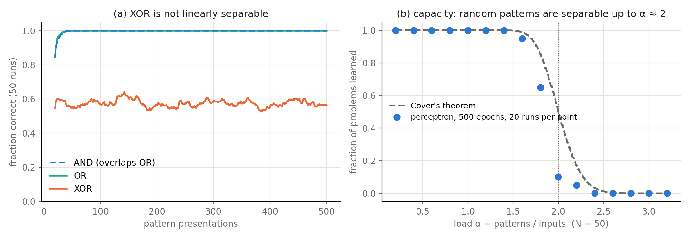

# Perceptron learning and storage capacity

What can a single neuron with adjustable synapses learn to classify, and how many
random associations can it store?

## Method

A perceptron `y = sign(w · x)` with ±1 inputs is trained online with the
perceptron rule `Δw = η (y_target − y) x` (η = 1, patterns presented in random
order).

1. **Boolean functions** AND, OR and XOR of two inputs (plus a constant bias input).
2. **Random patterns**: M random ±1 vectors of length N = 50, half labelled +1 and
   half −1. A problem counts as learned if every pattern is classified correctly
   within 500 epochs. The result is compared with Cover's theorem, which gives the
   fraction of random labellings that are linearly separable.

## Results



* **(a)** AND and OR are learned within a few dozen presentations. XOR is not
  linearly separable, so the accuracy never exceeds ~60 % no matter how long the
  perceptron is trained.
* **(b)** Almost every random problem is learned up to a load α = M/N ≈ 1.6. Above
  that, success drops sharply, and no problem is learned beyond α ≈ 2.4. This
  reproduces the classical capacity α_c = 2.
* Near the capacity, the simulation falls below Cover's curve because the
  perceptron needs more and more updates to converge there. At M = 100,
  increasing the budget from 500 to 4000 epochs raises the success rate from
  0.08 to 0.42, close to the theoretical 0.50.

## Run

```bash
python perceptron.py     # ~45 s, fixed random seed
```

## Notes

Built on an assignment from *Computational Modeling of Physiological Systems*
(AMS/BIO 332, Stony Brook University, Spring 2026), which compared M = 40 and
M = 90 patterns. The sweep over the load α and the comparison with Cover's
theorem were added here.
