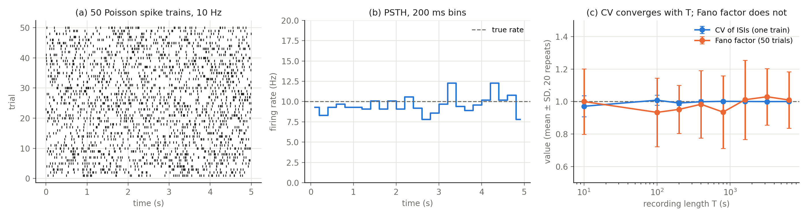

# Poisson spike trains and measures of neural variability

How irregular is a Poisson neuron, and how much data do we need to measure that
irregularity reliably?

## Method

Spike trains with rate λ = 10 Hz are generated from exponentially distributed
inter-spike intervals, `ISI = −ln(u) / λ` with u ~ U(0, 1). From 50 trials of 5 s:

* **PSTH**: trial-averaged firing rate in 200 ms bins
* **CV**: coefficient of variation of the ISIs within a train (1 for Poisson)
* **Fano factor**: variance / mean of the spike count across trials (1 for Poisson)

To see how reliable the estimates are, CV and Fano factor are recomputed for
recordings of 10 s to 6400 s, with 20 independent repeats at each length.

## Results



* Estimated rate 9.6 Hz, mean CV 0.98, Fano factor 1.03, all close to their
  Poisson values.
* **(c)** The CV converges as the recording gets longer. Its spread shrinks from
  ±0.07 at T = 10 s to ±0.004 at T = 6400 s, because it is averaged over more and
  more ISIs. The Fano factor does **not** improve with T: its spread stays at
  about ±0.2. It is estimated from only one count per trial, so its precision is
  set by the number of trials N (relative standard error ≈ √(2/(N−1)) = 0.20 for
  N = 50), not by the recording length.

## Run

```bash
python spike_trains.py     # ~5 s, fixed random seed
```

## Notes

Built on an assignment from *Computational Modeling of Physiological Systems*
(AMS/BIO 332, Stony Brook University, Spring 2026). The repeated-measurement
analysis in (c) and the explanation of the Fano-factor error were added here.
